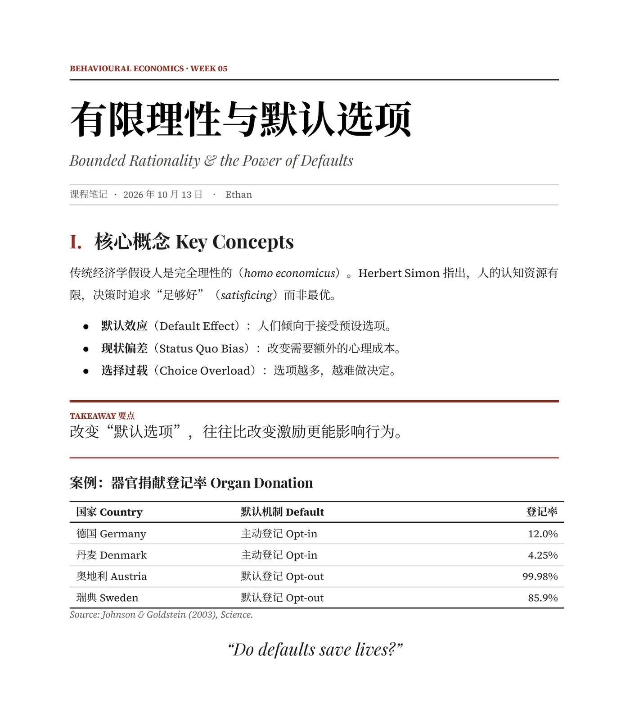
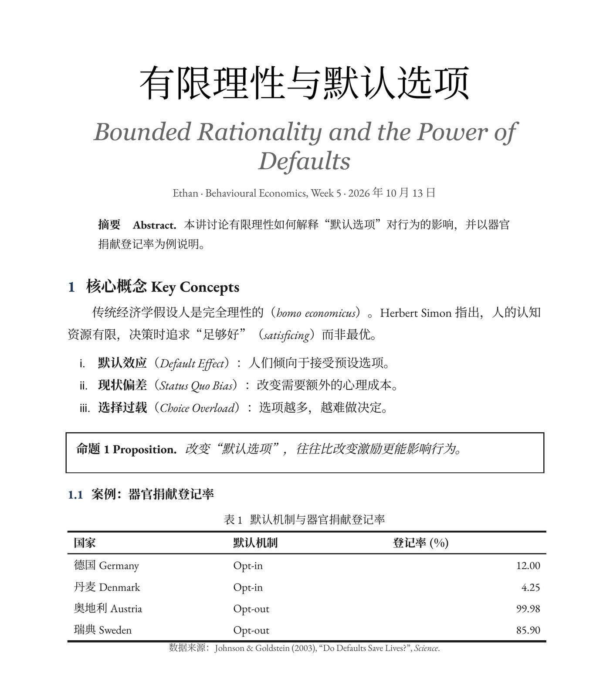

# styled-google-docs

一个 Claude Skill：通过 Google Docs / Drive 连接器**新建**文档时，一步生成排版精致、中英混排正确的文档，而不是 Docs 默认的 Arial 样式。

A Claude Skill that turns a new Google Doc created through the Google Docs / Drive connectors into a well-typeset, bilingual (Chinese + English) document in one pass.

| A · 编辑部杂志风 Editorial | C · 学术典雅风 Academic |
|---|---|
|  |  |

---

## 中文说明

### 两种风格

| 风格 | `--theme` | 适合 | 字体 |
|---|---|---|---|
| A 编辑部杂志风 | `editorial` | 课程笔记、读书笔记、计划、会议纪要 | Playfair Display / Source Serif 4 / Noto Serif SC |
| C 学术典雅风 | `academic` | 报告、方案、研究分析 | EB Garamond / Noto Serif SC |

### 工作原理

Drive 的 HTML 导入会把中文网络字体换成 Arial、丢掉段落边框、纸张设为 Letter。所以流程分两步：

1. `gdoc_style.py html`：把轻量 Markdown 转成带样式的 HTML，经 Drive `create_file` 导入为 Google Doc；同时生成段落角色清单 `manifest.json`。
2. `gdoc_style.py fix`：读取 `read_doc` 的结果，生成一次 `update_doc` 的全部请求：A4 纸张、段落间距与边框、对齐，以及给每段中文设置 `Noto Serif SC`（加粗用 700 字重，去掉中文斜体）。

完整步骤、Markdown 语法和设计规格见 [SKILL.md](SKILL.md)。

### 安装

- **Claude（Cowork / claude.ai）**：把整个文件夹打包成 zip，在设置的 Skills 里上传；或把 `SKILL.md` 内容作为新 skill 保存，并把 `scripts/` 一起放入。
- **Claude Code**：克隆到 `~/.claude/skills/styled-google-docs/`。

需要 Python 3（仅标准库），以及已连接的 Google Drive 和 Google Docs 连接器。

### 本地试用脚本

```bash
python scripts/gdoc_style.py html examples/sample-editorial.md --theme editorial --out out
# 用 out/doc.html 在 Drive 中创建文档，read_doc 保存为 doc.json 后：
python scripts/gdoc_style.py fix doc.json --manifest out/manifest.json --out fix.json
```

### 已知限制

- 页码与真正的脚注无法经 API/HTML 导入生成，需手动插入。
- 表格无法居中；不支持字距调整；小数字号会被取整。
- 仅用于新建文档；修改已有文档时只做最小改动。

---

## English

### Themes

| Theme | `--theme` | Best for | Fonts |
|---|---|---|---|
| A · Editorial | `editorial` | course notes, reading notes, plans, meeting notes | Playfair Display / Source Serif 4 / Noto Serif SC |
| C · Academic | `academic` | reports, proposals, research write-ups | EB Garamond / Noto Serif SC |

### How it works

Google Drive's HTML import replaces CJK web fonts with Arial, drops paragraph borders and uses Letter paper. The skill therefore works in two passes:

1. `gdoc_style.py html` converts a light Markdown file into styled HTML, which is uploaded with Drive `create_file` and converted into a Google Doc. It also writes `manifest.json`, the role of every paragraph.
2. `gdoc_style.py fix` reads the `read_doc` JSON and emits the arguments for a single `update_doc` call: A4 page, paragraph spacing and borders, alignment, and `Noto Serif SC` on every Chinese run (weight 700 for bold, no fake italics).

See [SKILL.md](SKILL.md) for the full workflow, the Markdown syntax and the design specs.

### Install

- **Claude (Cowork / claude.ai):** zip this folder and upload it under Settings › Skills.
- **Claude Code:** clone into `~/.claude/skills/styled-google-docs/`.

Requires Python 3 (standard library only) plus connected Google Drive and Google Docs connectors.

### Known limitations

- Page numbers and real footnotes can't be created through the API or HTML import; insert them by hand.
- Tables can't be centered; letter-spacing is unsupported; fractional point sizes are rounded.
- Built for new documents only; edits to existing documents stay minimal.

## License

[MIT](LICENSE)
